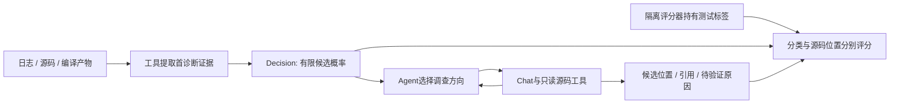

# 从概率接口到9B任务微调：实验为什么这样做

这条路线回答两个实际问题：怎样让软件快速拿到模型的判断，以及怎样让判断更符合内核首诊断任务。前者靠接口和推理部署，后者靠数据与微调。两种收益各有对照，不能混成一个数字。

配套[20页Slide](../deliverables/jev-decision-explained/deck.html)、[逐页讲稿](../deliverables/jev-decision-explained/逐页讲稿.md)。以下均为已有服务器实测的整理；本次L40验收没有产生新模型性能成绩。

## 1. 先理解任务：给异常分流，再查是哪段代码出了问题

假设日志写着`KASAN: use-after-free`。第一步判断“对象释放后又被访问”属于哪类异常，可以列出有限选项。第二步调查谁释放、谁访问、生命周期为何失配，需要读源码、符号化和工具反馈。分类做得准，有利于提供调查线索；最终根因仍要靠证据链核对。

候选概率表示在给定选项里的相对偏好。例如0.9不等于“根因已经有90%把握被证实”。报告组件、报错位置和引发故障的责任代码，也可能是三件不同的事。

## 2. 第一轮：先证明接口可以交付有用的结构化判断

通用Qwen无需换权重，SGLang Decision读取答案位置的字母logit，返回归一化候选概率；Chat则生成文本。三个问题可分别问家族、阶段和报告组件。前者省去自然语言格式组织、长答案生成与解析，并能直接供程序分支使用。

10月11日的135次接口消融中，三问题Decision平均1.145秒，结构化Chat平均2.075秒，耗时减少44.8%；故障家族两端27/27调用匹配，实际只有9个唯一案例、5个机制组。Chat也关闭了thinking，但需要输出结构化内容。因此这轮支持“所测结构化任务中更快交付有限结果”，不说明关闭思考后所有Chat都会慢44.8%。[原接口研究](../research/decision-localization-20261011/report.md)

## 3. 第二轮：专用PPLX权重让部署资源成为必须研究的变量

PPLX使用真实专门训练的backbone与独立readout，并按自己的提示格式和保存温度推理，不能给通用Qwen换个名字就代替它。BF16参数为52,173,271,520字节，即48.59GiB，还要额外放激活、KV和工作空间。

最初为与生产模型并存使用CPU卸载，观测平均19.455秒。随后在A100 80GB上分时全GPU驻留，PPLX平均5.672秒；同轮通用Qwen/SGLang平均2.563秒，两端9个唯一test案例各重复3次均匹配。前后两轮放置结果分开保留，不将CPU卸载作为公平全GPU对比的分母。[CPU条件](../research/pplx-decider-20261011/REPORT.md)、[全GPU对照](../research/pplx-timeshare-20261012/REPORT.md)

这里的工程结论很明确：模型能力要通过足够显存与匹配的执行引擎交付。PPLX当时走Transformers/SDPA参考实现，通用模型走SGLang；两者的内核、调度、读出与输入token也不同。该数据比较的是当时两个实际部署栈，不能用它证明专用决策模型本身必然更慢，也不能宣称只增加显卡就一定得到某个倍数收益。

## 4. 第三轮：把Chat压缩到一个字母，还剩多少收益？

为回答“是不是只是少输出文字”，后续对照关闭Chat思考、最多生成1个token，并逐项核对两接口的完整prompt token一致。在四任务并发、每任务八次顺序判断、题干预热且轮换选项的条件下：

| 模型与所测条件 | Decision整批秒 | 单字母Chat整批秒 | 耗时减少 |
|---|---:|---:|---:|
| 通用27B，四任务八步预热 | 3.634 | 4.085 | 11.03% |
| 微调9B，四任务八步预热 | 1.2803 | 1.3876 | 7.74% |

每格5次均值，两行为独立研究；不能把27B与9B时差全归给模型尺寸。长结构化输出的44.8%与这里的7.7%–11.0%使用不同基线，互不矛盾、不能相加。[27B矩阵](../research/kv-concurrency-20261016/REPORT.md)、[9B矩阵](../research/jev-qwen35-9b-20261016/REPORT.md)

两条路径都要处理输入。首个Chat字母可以直接来自prefill，max_tokens=1时不必再跑一次decode前向。Decision返回所有候选概率，但并未免除输入KV或混合注意力状态计算。9B四任务八步预热的活跃KV峰值均值为458.219/458.125MiB，不能声称Decision显著省显存；冷条件和单步结果也要保留。

八次决策是八个内部问题评分，缓存能否复用取决于真实token前缀；没有变成“题干只编码一次，任意选项免费”。Decision记录完整概率可用时间，Chat另记首个非空内容时间；整批指标是最后任务完成时间，不是完整根因报告时延。

## 5. 第四轮：9B为什么要微调，如何知道它学到了？

固定官方Qwen3.5-9B预训练基座，在两种内核构建的124条诊断日志上构造首诊断家族任务：train33、dev4、test87。跨构建按机制归组，再做划分和候选扩增；输入只含脱敏证据窗口、问题与选项，标签留在训练器或隔离评分器。

LoRA在48处投影训练5,308,416个参数，约占模型参数0.056%；rank8、alpha16，BF16骨干、FP32适配器。第一轮CE，后两轮CE+RLCD；33条×每轮4种候选×3轮=396微步，累计4步更新一次，共99次更新。dev选择epoch，合并为标准Qwen权重后，两端都用相同SGLang评估。

| 原冻结首诊断标签，多数票 | 基座9B | 微调9B | 增益 |
|---|---:|---:|---:|
| 全部87例 | 66/87，75.86% | 78/87，89.66% | **+13.79个百分点，净增12例** |
| stability构建42例 | 34/42，80.95% | 39/42，92.86% | +11.90个百分点 |
| OpenHarmony构建45例 | 32/45，71.11% | 39/45，86.67% | +15.56个百分点 |
| 显式warning/panic类20例 | 8/20 | 19/20 | 净增11例 |

这是应当展示的任务适配收益。每例三种候选排列取多数，87例没有变成261个独立案例。Decision和关闭思考的单字母Chat在两权重上各自也分别66/87与78/87，因此增益属于本轮微调方案，不是换接口带来的准确率提升。[冻结汇总](../research/jev-qwen35-9b-20261016/summary.json)

这里的“分类”专指第一诊断家族。旧规则标签含4条已知`circular`误命中`rcu`的问题，历史分数不改写，按原标签完整展示；审计见[标签说明](首诊断弱标签RCU子串误判审计_20261018.md)。它不等于专家根因、引入提交或修复成功率。20个机制簇的探索性区间触及零，不能改称跨机制显著提升。新数据流程要求逐条核对证据和标签，并用新版本另测。

本轮没有同预算CE-only或多seed结果，因此收益来自整个训练与选择方案，不能单独归功于RLCD。NLL也没有随分类一起改善；部署概率是否可信应另做校准验收。分类优势可以如实展示，无需把它扩展成未测的能力。

## 6. 给开发者解释：标签和概率怎样进入训练？

一条样本保存证据文本、机制组、split、类别与审核信息。训练时随机挑候选、打乱顺序，若正确类在当前C位置，target就是索引2；不能固定“正确答案永远是A”。模型前向产生字母logits，CE用target监督。RLCD在可微logits附近采样扰动、softmax为概率，再用真实类别计算奖励与优势，损失沿logits回传LoRA。

HTTP返回的概率JSON是部署产物，没有连接训练autograd图，不能把它直接交给optimizer。完整公式、数据合同、固定revision、命令、导出和验收见[复现指南](决策模型开发与微调复现指南_20261018.md)与两份[数据skill](../skills/ai4loc-decision-data/SKILL.md)、[微调skill](../skills/ai4loc-decision-finetune/SKILL.md)。Laya是开源参考思路；本项目没有复现TypeSafe Jev私有训练配方。

## 7. 分类结果如何接回定位系统？

独立32k检查使用UAF、ABBA锁和hung task三例，两个权重都运行纯Chat与Decision定界+Chat调查。混合流程微调前10次HTTP、53.464秒，微调后6次HTTP、29.247秒；源码位置命中均2/3。同轮微调后纯Chat是3次HTTP、23.229秒，也2/3。[完整流程统计](../research/jev-qwen35-9b-20261016/tables/agent32k-aggregate.csv)

这说明分类、调用策略、最终定位应分别计量。混合流程在此三例减少了调用与耗时，但纯Chat仍更快；已有数据没有证明根因准确率提高。实际选择要看是否需要可审计的早期概率，以及它能否减少后续工具或模型轮次。

## 8. 本次L40验证如何衔接？

本次L40用于验收交付的skill是否能在新Linux环境正确工作，不把它混进上述A100历史分数。服务器已有GPU计算任务持续运行，因此仅运行低优先级CPU合同、训练计划、worker生成及协议检查；不安装到全局、不启动CUDA、不停止现有任务。11项检查通过，完整GPU训练和真实SGLang仍需空闲GPU窗口。[服务器验收记录](../research/decision-skills-l40-20261018/README.md)

到这里，实验与开发能连成一条可理解的链：有限概率接口解决软件如何调用，部署实验说明资源与运行时如何影响交付，单字母基线量化接口剩余收益，9B微调提高本任务分类，完整Agent再验证工具与报告成本；skills把这条路线变成可复用步骤。
