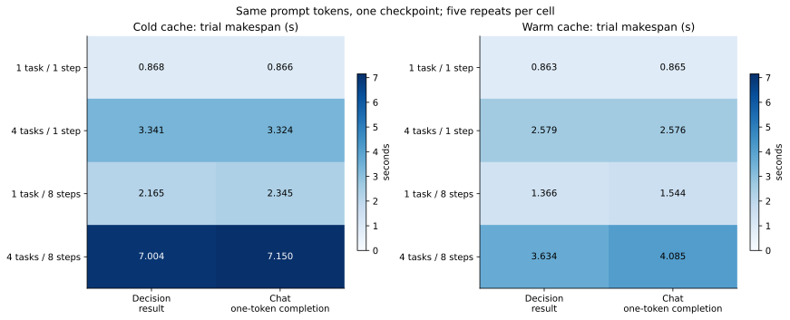
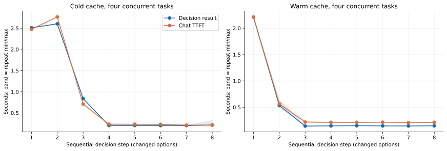
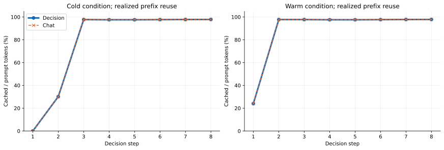
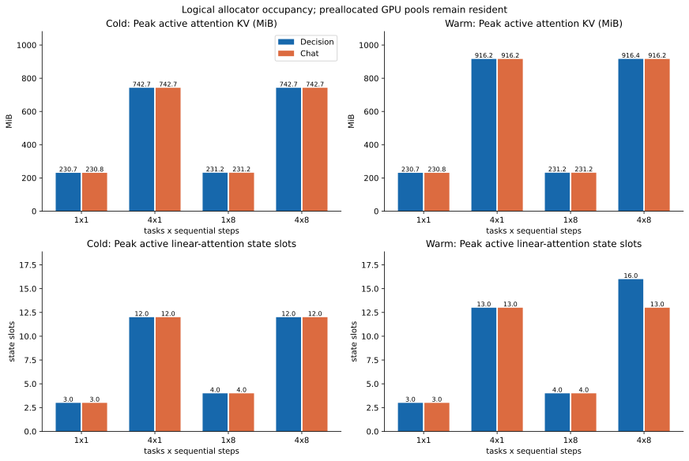
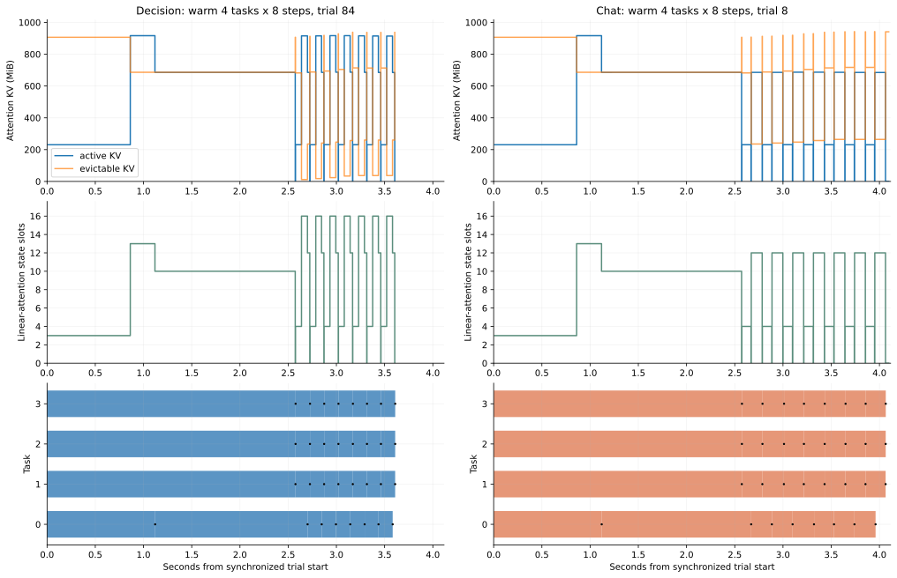
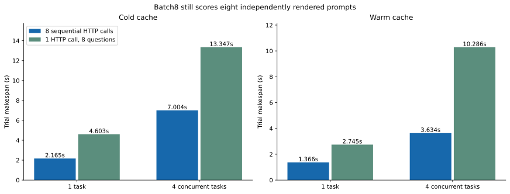

# Qwen3.8 Jev-like Decision：并发请求、前缀复用与 KV cache 实测

执行日期：2026-10-16（北京时间）；实验目录名称中的 20261015 为跨午夜启动的采集校准，20261016 为正式故障窗口实验。以下数值来自服务器实际调用；不是估算或官方性能数据的移植。

## 1. 结论与适用范围

在真实故障窗口、4 个并发任务、每任务 8 次顺序决策、已预热相同题干而更换选项的条件下，Decision 的整批任务完成时间均值为 3.634s，单字母 Chat 为 4.085s，变化为 11.03% 的耗时减少。是否提速必须按下面的缓存状态和任务组合分别判断，不能只引用这一格。

Decision 没有输出文本 token。它的客户端指标是完整概率结果可用时间，不存在真正的文本 TTFT。本文同时记录 Chat 首个非空内容到达、首个 HTTP body、HTTP 头和请求完成，比较的是有限选择场景的结果就绪时间；不把 Decision 的非流式总耗时命名为“首 token 时间”。

两接口使用同一权重和同一已加载实例，固定预分配的 attention KV 池为 5.532GiB，线性注意力状态池为 32 个槽。切换接口不会释放这一整块预分配显存。能否节省活跃 KV，须看实际 token 槽数；不能从“不生成文本”推导出“不需要 KV cache”或“显存大幅下降”。

关键内存结果：热条件4×8下，Decision/Chat的平均trial峰值活跃attention KV为 916.438/916.250MiB，活跃linear状态峰值为 16/13槽。此条件下Decision没有更省活跃KV，状态槽峰值反而更高；NVML观测峰值均值 68749.6/68748.4MiB，也不支持有实际整卡显存节省。

最重要的运维发现：生产配置虽然传入 max-running-requests=4，SGLang 实际把并发上限降到了 1。自动分配的线性注意力池只有 9 个槽，extra_buffer 策略每请求预算 5 个槽，floor(9/5)=1。正式实验在隔离端口扩大池，确认有效上限及实际最大调度批次均为 4；实验后恢复原配置，没有把实验参数直接部署到生产。

## 2. 模型、硬件和实验隔离

| 项目 | 实际值 |
| --- | --- |
| GPU | NVIDIA A100-SXM4-80GB, 580.126.09, 81920 MiB |
| 软件 | sglang=0.5.21, torch=2.13.0, transformers=5.12.1, aiohttp=3.14.3 |
| 模型 | 本地 Qwen3.8-27B；served-model-name=Qwen3.8-27B-SystemOne；通用模型 Decision 接口，非 PPLX 专用权重 |
| 注意力结构 | 64 层：16 层 full attention + 48 层 linear attention；权重 BF16；SSM 配置 FP32 |
| 正式实例 | 127.0.0.1:30003；mem_fraction_static=0.78；max_mamba_cache_size=32；有效并发4 |
| 固定参数 | context=8192；chunked_prefill=8192；max_prefill_tokens=16384；radix cache 开启；extra_buffer；track interval=256 |
| 后端 | attention=flashinfer；linear=triton；overlap schedule 开启 |
| 预分配 | 权重报告 51.051GiB；KV 5.532GiB；KV容量 90635 token |
| 独占方式 | 先确认无业务任务、PPLX端口未运行；暂时卸载原通用模型；独立监护进程在故障或超时后恢复原Supervisor |
| 恢复 | 原30000端口和原配置恢复；30003实验实例退出；PPLX保持测试前的未启动状态 |

此处的 Qwen3.8 名称取自真实部署与目录；报告同时保留实际 config.json、安装版本和源文件 SHA256。没有下载不同权重、变更精度或启用专用决策头。原配置和正式配置使用不同输入窗口，因此两轮之间的时间差不能被解释为“单独扩大状态池带来的提速”。

## 3. 预注册矩阵与输入构造

| 维度 | 取值与控制 |
| --- | --- |
| 任务并发 | 1 / 4；同一 asyncio Event 同时放行；任务之间使用4个不同现有日志窗口 |
| 任务内决策次数 | 1 / 8；主实验内同任务顺序调用，下一次在上一次返回后发送 |
| 题干与选项 | 同任务日志和问题文本固定；8组有序选项集合不同，每组5选项；没有把历史答案追加到下一步 |
| 接口 | Decision /v1/decisions；Chat /v1/chat/completions stream=true，max_tokens=1，thinking=false |
| 输入对齐 | 主实验及敏感性对照共 465 对服务端完整 prompt token SHA256 一致 |
| 冷缓存 | 每个 trial 前 flush_cache；不是每次决策前清空，故同一 trial 内第2至8步可复用前缀 |
| 热缓存 | flush 后逐任务用相同题干、另一组选项 step11 预热；预热不计入正式耗时和分母 |
| 重复与顺序 | 每格5次；seed=20261015；80个主trial +20个batch8 trial +12个观测敏感性trial，合计112 |
| 批量补充 | Decision一次HTTP携带8个问题；1/4任务 × 冷/热 × 5重复，共20个trial |
| 额外观测敏感性 | 关闭额外调度快照和50ms轮询，1/4任务单步冷缓存，3重复；原生导出、原生metrics及NVML仍保留 |

从已有 stability-v1 数据中按 manifest 顺序选取最先满足诊断正则的4份 agentLog；只使用文件内容，不向模型发送 manifest、case ID、split、注入标签或参考答案。窗口从首条匹配诊断前1000个 Unicode 字符起，最多6000字符。原始文件哈希、窗口偏移和文本保存在私有证据中，公开协议只保存哈希与构造规则。

这是一项接口与缓存性能测试。五选项在不同步骤变化，部分集合可能没有正确根因类别；模型没有执行工具搜索或输出根因报告。因此不计算定位准确率、不宣称准确率不降，也不把本轮问题次数与早期135次或PPLX121次研究合并。

| 任务输入 | step0 prompt token数 | Decision / Chat token完全一致 |
| --- | --- | --- |
| 0 | 3691 | True |
| 1 | 3673 | True |
| 2 | 3579 | True |
| 3 | 3717 | True |

## 4. 记录了哪些时间点与缓存量

| 层次 | 采集点 / 字段 | 单位与限制 |
| --- | --- | --- |
| 客户端 | start_wall_ns、start_mono_ns、headers、first_body、first_content、end；每个SSE事件/内容到达 | 同一服务器客户端；时长用monotonic差，墙钟用于对齐；连接保持复用 |
| 服务端每个问题 | request_received_ts、dispatch_finish、queue_time、forward_entry、prefill_finished、request_finished、response_sent | 原生导出；forward→prefill_finished 是服务端观测区间，不是CUDA event纯kernel时长 |
| 调度器每次前向与结果处理 | run_batch.before/after；process_batch_result.before/after；请求rid、prefix_tokens、input/output tokens、队列长度 | Python import hook，仅隔离实例继承；不修改已安装SGLang，不插入CUDA同步 |
| Attention KV | full_num_used、available、evictable、capacity；active/evictable MiB | 活跃、空闲和可回收缓存是不同概念；16层KV每token=65536字节=64KiB |
| Linear attention | mamba_num_used、available、evictable、usage | 状态槽数，不是token数；不能与attention token数相加 |
| CUDA allocator | torch_allocated、reserved、lifetime peak allocated | 当前分配与缓存保留分开；lifetime peak不是每trial重置的峰值 |
| Prometheus | 约50ms+HTTP开销轮询，保留gauge/counter变化 | Gauge只在调度器更新时刷新，连续重复读数不代表每次重新查询allocator |
| NVML | memory used/free、GPU/memory utilization、温度、功耗、SM/显存频率 | 请求间隔100ms；短时峰值可能落在两次采样之间，不能称绝对连续峰值 |

正式采集 4844 个调度快照、7904 条快照内请求记录、6743 个 Prometheus 采样、5548 个 NVML 采样。快照取值准备开销 p50=420.1μs、p95=1027.9μs，此数不含之后的JSON序列化和文件写入；Prometheus HTTP耗时 p50=10.19ms、p95=12.09ms；NVML相邻采样间隔中位数 100.00ms。

KV 字节换算：2(K,V) × 16(full attention层) × 4(KV heads) × 256(head dim) × 2(BF16 bytes) = 65536 bytes/token。这里只是 attention KV 的有效数据量，不含线性状态、padding、权重、图捕获内存、激活或CUDA保留空间。表中的“峰值”若来自快照，准确含义是观测到的最大值。

## 5. 单任务 / 四任务、单步 / 八步的结果

冷缓存；均值，每格5个trial。整批完成时间是最后一个并发任务返回的时间；单次调用指标按trial内均值后再跨trial平均。

| 任务×步数 | Decision整批s | Chat整批s | Decision单次结果s | Chat单次TTFT s | Decision整批耗时减少 |
| --- | --- | --- | --- | --- | --- |
| 1×1 | 0.868 | 0.866 | 0.867 | 0.866 | -0.15% |
| 4×1 | 3.341 | 3.324 | 2.493 | 2.473 | -0.51% |
| 1×8 | 2.165 | 2.345 | 0.270 | 0.292 | +7.70% |
| 4×8 | 7.004 | 7.150 | 0.872 | 0.884 | +2.05% |

热缓存；均值，每格5个trial。整批完成时间是最后一个并发任务返回的时间；单次调用指标按trial内均值后再跨trial平均。

| 任务×步数 | Decision整批s | Chat整批s | Decision单次结果s | Chat单次TTFT s | Decision整批耗时减少 |
| --- | --- | --- | --- | --- | --- |
| 1×1 | 0.863 | 0.865 | 0.862 | 0.864 | +0.19% |
| 4×1 | 2.579 | 2.576 | 2.214 | 2.211 | -0.11% |
| 1×8 | 1.366 | 1.544 | 0.170 | 0.192 | +11.57% |
| 4×8 | 3.634 | 4.085 | 0.453 | 0.507 | +11.03% |

图1：主实验整批完成时间，冷/热分开。对角不同工作量不能直接当吞吐或单次TTFT比较。

| 缓存 | 任务×步数 | Decision耗时减少 | 重复级bootstrap 95%区间 |
| --- | --- | --- | --- |
| cold | 1×1 | -0.15% | [-0.54%, +0.17%] |
| cold | 4×1 | -0.51% | [-1.36%, +0.01%] |
| cold | 1×8 | +7.70% | [+7.37%, +8.08%] |
| cold | 4×8 | +2.05% | [+1.17%, +2.53%] |
| warm | 1×1 | +0.19% | [-0.26%, +0.73%] |
| warm | 4×1 | -0.11% | [-0.31%, +0.13%] |
| warm | 1×8 | +11.57% | [+10.86%, +12.25%] |
| warm | 4×8 | +11.03% | [+9.74%, +12.24%] |

区间按相同配置、相同repeat编号配对，重采样5个重复块20000次。4个任务和8个步骤在同一trial内相关，未作为独立样本扩大分母。这些区间只描述这4个固定输入、当前硬件和运行状态的技术重复波动，不代表新故障总体的泛化区间；未做跨机制显著性声明，也不以区间排除0作为普适优势证据。P95仅有5个trial，不应视为稳定SLA尾延迟。

图2：四任务八步中，每一步的结果就绪时间；Decision完整概率结果、Chat真实首内容。阴影为5个重复均值的min/max，不是置信区间。

“热”只表示按协议做过不同选项的prime，不保证后续每题命中缓存。本轮1任务1步热条件两接口的实际cached_tokens都是0，几乎没有提速；应以实际命中数判断，不能把预热操作本身当成命中证据。相同题干不等于存在可复用的完整hybrid状态；仅凭这些轨迹还不能唯一归因到某一种内部checkpoint策略。

补充图：四任务八步的实际前缀命中率；每一步聚合原生cached_tokens / prompt_tokens。日志和题干固定，选项变化，依然可能发生缓存未命中。

## 6. KV、线性状态与整卡显存

冷缓存：每个trial内最大活跃占用，再跨5次取均值；NVML列为采样最大整卡used值的均值，非可被请求独占归因的内存。

| 任务×步数 | 接口 | 活跃KV MiB | 活跃状态槽 | 实际cached/prompt | NVML used MiB | 平均排队ms |
| --- | --- | --- | --- | --- | --- | --- |
| 1×1 | decision | 230.688 | 3.000 | 0.00% | 67580.000 | 0.407 |
| 1×1 | chat | 230.750 | 3.000 | 0.00% | 67580.000 | 0.372 |
| 4×1 | decision | 742.688 | 12.000 | 0.00% | 68414.400 | 0.541 |
| 4×1 | chat | 742.688 | 12.000 | 0.00% | 68414.800 | 0.516 |
| 1×8 | decision | 231.188 | 4.000 | 72.77% | 67724.000 | 0.343 |
| 1×8 | chat | 231.250 | 4.000 | 72.77% | 67724.000 | 0.424 |
| 4×8 | decision | 742.688 | 12.000 | 77.05% | 68706.400 | 0.726 |
| 4×8 | chat | 742.688 | 12.000 | 77.05% | 68850.400 | 129.357 |

热缓存：每个trial内最大活跃占用，再跨5次取均值；NVML列为采样最大整卡used值的均值，非可被请求独占归因的内存。

| 任务×步数 | 接口 | 活跃KV MiB | 活跃状态槽 | 实际cached/prompt | NVML used MiB | 平均排队ms |
| --- | --- | --- | --- | --- | --- | --- |
| 1×1 | decision | 230.688 | 3.000 | 0.00% | 67580.400 | 0.487 |
| 1×1 | chat | 230.750 | 3.000 | 0.00% | 67580.400 | 0.495 |
| 4×1 | decision | 916.250 | 13.000 | 24.01% | 68314.400 | 0.756 |
| 4×1 | chat | 916.250 | 13.000 | 24.01% | 68314.000 | 0.790 |
| 1×8 | decision | 231.188 | 4.000 | 84.90% | 67724.800 | 0.332 |
| 1×8 | chat | 231.250 | 4.000 | 84.90% | 67724.400 | 0.364 |
| 4×8 | decision | 916.438 | 16.000 | 88.50% | 68749.600 | 0.575 |
| 4×8 | chat | 916.250 | 13.000 | 88.50% | 68748.400 | 9.982 |

图3：attention KV与linear状态独立显示。池中的可回收缓存不等于正在被请求锁定的KV，也不等于释放回CUDA的内存。

整轮NVML观测范围为 66576–69144MiB。该范围包含预热、prime和不同形状的临时分配，不能把范围两端相减称作Decision节省的显存。相同实例下两接口共享固定池；应结合每个条件的活跃槽数、torch allocated/reserved、NVML及请求队列一起解释。

只输出一个字母的Chat也主要是在prefill后读取首个生成token，没有长篇decode负担。Decision返回5项分布而Chat返回一个选项；接口额外工作和输出语义不同。若二者活跃KV只相差少量位置，不能宣传成数量级省内存。对长篇Chat推理、thinking开启或根因报告生成的显存与TTFT，本轮没有做对照。

图4：各接口分别选热缓存4×8配置中整批时间最接近中位数的真实trial。时间轴是调度边界采样的阶梯示意，不保证GPU异步执行间隙内资源始终不变；底部横条为HTTP在途，黑点为结果可用/Chat首内容。

## 7. 一次携带八题是否更快

| 缓存 | 并发任务 | 8次顺序s | 1次8题s | 批量耗时减少 | 顺序峰值KV MiB | 批量峰值KV MiB | 批量最大排队ms |
| --- | --- | --- | --- | --- | --- | --- | --- |
| cold | 1 | 2.165 | 4.603 | -112.63% | 231.188 | 692.312 | 4470.098 |
| cold | 4 | 7.004 | 13.347 | -90.57% | 742.688 | 697.688 | 12915.285 |
| warm | 1 | 1.366 | 2.745 | -101.03% | 231.188 | 692.312 | 2644.732 |
| warm | 4 | 3.634 | 10.286 | -183.02% | 916.438 | 920.562 | 9887.428 |

图5：批量与顺序都回答同样8个独立问题。HTTP请求数减少不等于8题只做一次prefill；原生接口为每题独立渲染prompt并调度。

同题干不同选项只能复用分歧位置以前的可缓存前缀。题目批量进入时，第一题的前缀可能尚未计算或未形成可复用的linear状态；多个不同输入也竞争状态槽和prefill token预算。顺序请求则能等前一步结束后再命中缓存。因此批量收益必须从表中读取，不能预设一定加速。此次没有实现跨题单次隐藏状态共享的新算法，也未把8题压成一次推理后重复使用同一个答案。

## 8. 观测成本、校准记录与效度边界

| 任务数 | 接口 | 额外观测开启s（5次） | 关闭s（3次） | 均值变化 |
| --- | --- | --- | --- | --- |
| 1 | decision | 0.868 | 0.866 | +0.16% |
| 1 | chat | 0.866 | 0.866 | +0.01% |
| 4 | decision | 3.341 | 3.324 | +0.50% |
| 4 | chat | 3.324 | 3.324 | +0.00% |

此敏感性检查仅关闭额外Python快照和Prometheus轮询；NVML、SGLang原生metrics、请求导出及日志仍开着，不能称为“完全无监控基准”。两组重复次数不同、时间位置不同，均值变化含运行波动；不把正负变化全归为监控本身的因果开销。

前一轮启动区段采集完整保留：112个trial、980个正式HTTP调用、1330个内部问题评估、7764个调度快照，最大实际批次1。其最初6000字符主要是启动上下文，随后正式轮改用首诊断窗口并扩大状态池。这轮只作采集和原配置受限状态校准，不混入正式平均数、不作为故障定位准确率证据，也不与正式轮做单因素性能归因。校准取消时发出的SIGINT在nohup子进程中被继承为忽略，因而该轮最终正常跑完；completion记录为completed。

其余限制：只有同一张A100、单机loopback、4个固定故障窗口；没有外网RTT、真实用户持续到达过程、混合Chat长文流量、并发8/16/32或不同上下文长度曲线。服务器其它CPU进程与温度频率未锁定；NVML记录功耗/温度/频率以便复核，采集校准的离线导出曾与正式轮前段重叠，可能带来CPU扰动。模型编译/图捕获和全局预热在正式计时之前，prime排除；本轮不测首次加载冷启动。

## 9. 数据完整性与逐请求复核

| 检查 | 正式故障窗口结果 |
| --- | --- |
| 主/补充/敏感性trial | 112 |
| 正式HTTP调用 | 980 |
| 内部问题评估 | 1330 |
| 唯一关联成功的正式内部请求 | 1330 |
| HTTP全部成功 | True |
| Chat合法单字母输出 | 465/465 |
| Decision概率检查 | 每题概率和≈1，choice属于给定选项，completion_tokens=0 |
| 排除 | 每轮2个全局接口预热、125个不同选项prime；4个token对齐预检及SGLang启动健康生成另记 |
| 关联方法 | 完整prompt token SHA256 + 原生received时间落在客户端起止±2ms，且只有1候选；正式问题全部满足 |
| 匿名与数据 | 不发送case路径、标签或参考答案；完整业务日志、请求文本、原进程环境不发布到Git |

所有HTTP调用、内部问题数、trial和任务数是不同统计单位；一次batch8 HTTP对应8个内部问题。未匹配的启动/预检或边界相邻预热记录保留在audit.json，不强行归给正式任务。调用的完整概率、选项协议、每个SSE到达点和服务端rid均可复核；不只保存平均值。

[逐trial统计和峰值](tables/trials.csv)

[逐HTTP调用、TTFT和头/体时间](tables/calls.csv)

[每个内部问题的排队/prefill原始时间](tables/server-requests.csv)

[每个调度边界的KV/状态/CUDA分配](tables/scheduler-snapshots.csv)

[调度边界内的请求与prefix长度](tables/scheduler-requests.csv)

[NVML每时间点的显存/温度/功耗/频率](tables/gpu-samples.csv)

[Prometheus采样值](tables/prometheus-samples.csv)

[冻结协议](data/protocol.json)

[完整有限概率与SSE到达记录](data/answers-and-arrivals.jsonl)

[对齐和计数审计](data/audit.json)

[原配置校准数据](../kv-concurrency-20261015/data/audit.json)

完整私有原始证据留在服务器 /opt/kernel-insight/experiments/kv-concurrency-20261016/，并下载到本地Git忽略目录 data/local-archive/kv-concurrency-20261016/retained-evidence.tgz。归档 54899444 字节、1136 文件，SHA256=66374918d1fab184a3a37898008851061e7bde02a9148bcd6c21a728c4660e99。两轮各1136文件均完成本地逐文件SHA256复核；捕获的原进程环境和恢复lease明确排除。

[独立完整性核验结果](verification.json)

[原服务恢复后的真实Decision / Chat推理验证](post-restoration-validation.json)

## 10. 对现有Agent和部署的建议

有限候选定界可以采用Decision以获得结构化概率与免解析输出；是否采用批量8题，应根据本表的冷/热与并发条件选择。优先维持日志/源代码摘要在提示的固定前部，把会变化的选项放后面，并保留可缓存prefix，避免每一步把不相关历史追加到题干前部。

部署前必须读取effective_max_running_requests_per_dp和实际状态池，确认它们与CLI意图一致。当前生产配置仍只有1个有效请求容量；本轮已验证的隔离配置是静态显存比例0.78、FP32状态槽32、有效容量4，但它占用更多预分配显存，不能当作免费提速或已完成的生产调优。上线前还需在完整Agent混合负载下验证容量、超时及恢复。

根因分析仍需要Chat或其它能调用工具并形成证据链的Agent；本轮只测有限决策接口，不能据此声称根因定位整体耗时、报告输出耗时或准确率已经改善。下一轮应固定完全相同的故障窗口和缓存策略，在同一配置中测试短选项、工具规划及长报告的真实混合负载。

## 11. 复现与资料

已保留 benchmark.py、sitecustomize.py、orchestrate.py、export.py、retain.py、analyze.py 和本构建器。分析只需Python、NumPy、Matplotlib；在本目录执行 python analyze.py，再执行 python build-report.py。运行服务器控制器属于维护操作，不应直接在已有同名实验目录重跑；脚本会拒绝已有lease，避免覆盖。新实验需建立新的空目录、复核业务队列及状态、冻结协议后执行。

参数影响：mem-fraction-static 决定模型与持久池的静态预算；max-mamba-cache-size 决定混合模型状态池容量；mamba-full-memory-ratio 仅在自动分配时影响两类池配比，显式32槽应看最终resolved值；max-running-requests 是意图上限，实际仍受状态/显存限制；max_tokens=1、thinking=false 是本次Chat有限选择控制条件；Decision temperature=1用于标签概率归一化，不能与Chat temperature=0解释成相同采样过程。

[SGLang官方Decision接口语义](https://docs.sglang.io/docs/supported-models/decision_models)

[SGLang官方监控指标说明](https://docs.sglang.io/docs/references/production_metrics)

解释优先依据本服务器安装的SGLang源码，相关文件SHA256见provenance.json：serving_decisions.py、tokenizer_manager_score_mixin.py、pool_stats_observer.py、kv_cache_configurator.py和req_time_stats.py。官方网页可能继续更新，不能用新版能力反推本轮0.5.21已经启用。
