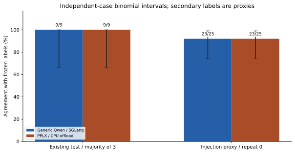
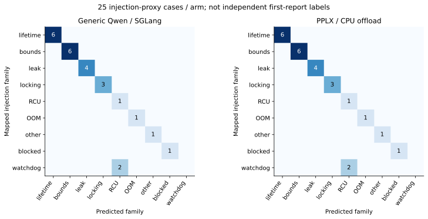
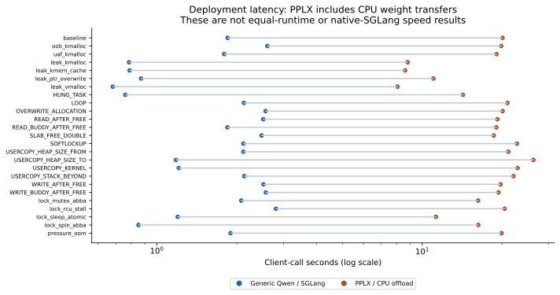
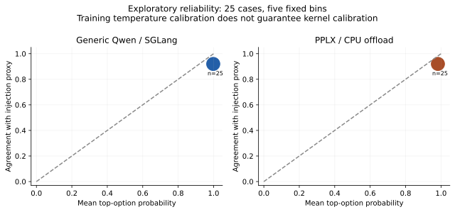

# PPLX-Decider 专用权重实测报告（2026-10-11）

2026-10-12更新：本页保留CPU卸载历史条件与冻结数据。最新[全GPU分时复测](../pplx-timeshare-20261012/REPORT.md)已完成，两端test均27/27，PPLX均值5.672s、通用2.563s；旧CPU速度不作公平对照。部署步骤见[中文手册](../../docs/PPLX专用模型下载部署与验收手册.md)。

本报告测试真实专用权重，而非更改通用模型别名。实验、失败、概率及输入哈希全部保留。

模型：`perplexity-ai/pplx-decider-v1-27b`；固定 revision：`b01a5cbaca5391f73bd55103d4f27e8982cd5e60`。30 个文件按官方元数据校验，所有 11 个权重分片 SHA256 通过；使用专用 readout 和保存的 temperature=2.207568022。

## 实验条件与可解释范围

单张 A100-SXM4-80GB，原有通用 Qwen/SGLang 继续驻留。专用模型采用官方参考 prepare/forward、BF16、Accelerate CPU 卸载，GPU 权重额度 10 GiB；仅改变放置方式，未替换权重、答案读出或温度。运行时为 Torch 2.13.0、Transformers 5.12.1、Accelerate 1.15.0。原版构造器的整模型 .to(cuda) 由显式分层放置替代。**该条件验证权重、接口与有限分类能力；耗时包含 CPU 权重传输，不能推断全 GPU PPLX 或原生 SGLang 的速度。**

两端均通过 `/v1/systemone`，相同日志状态、三个固定问题与选项；每个 worker 为匿名 UUID `/work`，无评测父目录、业务数据或 proc 挂载。协议与随机顺序在正式调用之前冻结，seed=20261011。模型侧不接收独立的案例 ID、注入类别、标签或评分字段；自然日志中的函数名与工作负载线索保留。

9 个已有 test 案例各 3 次×2 模型=54；16 个其他可映射 train 案例各 1 次×2=32；35 个 protection/refcount 案例仅 PPLX 各 1 次=35。共 121 正式调用，另排除 2 次合成预热。后 35 例无兼容家族真值，准确率为空。材料均为现有脱敏日志；未测源码根因或提交定位。

## 实际结果

| 指标 | 通用 Qwen / SGLang | PPLX / CPU 卸载 |
| --- | --- | --- |
| test 正确调用/27 | 27/27 | 27/27 |
| test 唯一案例多数正确/9 | 9/9 | 9/9 |
| test 平均客户端秒 | 1.485 | 19.455 |
| test P95 秒 | 3.034 | 22.868 |
| test 输入 token 总数 | 302931 | 325638 |
| test 输出 token 总数 | 0 | 0 |
| 25 例注入类别代理吻合（repeat=0） | 23/25 | 23/25 |

## 统计与概率分析

test 案例级配对 McNemar：通用独对 0、PPLX 独对 0，双侧精确 p=1.000000。25 例 repeat=0 对照 p=1.000000。这是探索性准确率比较，不是预设非劣/等效证明；重复调用不是新的独立案例。

| 概率诊断（25例 repeat=0） | 通用 | PPLX |
| --- | --- | --- |
| 多类 Brier（越低越好） | 0.158 | 0.154 |
| 5固定分箱 ECE（描述性） | 0.078 | 0.062 |

分箱和 Brier 使用冻结映射后的注入家族作为目标，仅 25 个既有案例且包含 train；不能声称完成独立领域概率校准，更不能把高概率等同根因正确率。阶段和 reporter 的实际选项/概率已保留，但没有独立专家真值，未给出其准确率。

## 标签不一致与未评分案例

| 案例 | split | 模型 | repeat | 目标家族 | 返回 |
| --- | --- | --- | --- | --- | --- |
| lkdtm_LOOP | train | pplx | 0 | watchdog_lockup | rcu_progress |
| lkdtm_LOOP | train | generic | 0 | watchdog_lockup | rcu_progress |
| lkdtm_SOFTLOCKUP | train | pplx | 0 | watchdog_lockup | rcu_progress |
| lkdtm_SOFTLOCKUP | train | generic | 0 | watchdog_lockup | rcu_progress |

35 个 protection/refcount 案例的 family/stage/reporter 输出位于公开派生表，correct=null；没有把未知真值强制映射为“其他”凑准确率。所有正式失败也保留在分母。重要的构念差异：secondary 的目标来自注入家族，而提问要求识别第一条诊断，二者可能不同。例如 lkdtm_LOOP 标为 watchdog，但实际首条诊断是 RCU stall，两模型都选择 rcu_progress。因此上述不一致不能自动称为模型错误；原始标签得分不事后改写，需独立诊断标注后再评价首现场准确率。

## 结论与后续验证

在现有 test 上，PPLX 多数正确 9/9，通用模型 9/9；25 例单次对照为 23/25 与 23/25。结论只适用于这个已知回归集合。

专用模型已实际接入现有 DecisionClient 的 System One 适配，并返回三个问题的选择及有限分布；接口名称相同不意味着已测原生 dsh SDK 全流程。本轮没有更换网站的生产模型，也没有重启 SGLang/Ollama。

若要判断专用权重是否提速，需要独立 GPU，或在已批准维护窗口中卸载当前通用模型、使用支持专用 checkpoint 的 SGLang 版本，以一致 BF16、上下文、并发和缓存条件重测。本轮 CPU 卸载耗时不能替代这一结论。是否提升根因定位还须在同一 Chat/源码工具/预算下做完整 Agent 对照及新机制盲测。

## 数据、来源与复现

- `results/trials.csv`、`trials.json`：121 次派生数据与选项概率；无原始输入/Prompt/账号/token ID。
- `results/protocol.json`、`runtime.json`、`checkpoint.json`：冻结协议、实际放置与官方校验摘要。
- `python analyze.py --public`：离线重算统计及四组 SVG/PNG，不调用模型。
- 私有服务器目录 `/opt/kernel-insight/experiments/pplx-decider-20261011/`；本地 `data/local-archive/pplx-decider-20261011/`。

官方模型与许可证：[Hugging Face](https://huggingface.co/perplexity-ai/pplx-decider-v1-27b)。[SGLang 部署说明](https://docs.sglang.io/cookbook/autoregressive/Perplexity/PPLX-Decider-v1-27B)。源代码和权重校验来自官方模型仓库固定 revision；镜像仅作传输，不作为模型身份依据。

## 完整性、泄露复核与服务状态

121/121 调用成功，121/121 匿名 worker 检查通过，121/121 实际请求轨迹通过字段复核，冻结源码哈希一致。完整私有归档 626206 字节，SHA256 `0b6b2f6608eae8c819abe173c2ab1dec8319fc17abc23f33721e728131538a61`；本地归档及其中 518 个文件逐一核验一致。

模型请求没有 caseId、gold、injectionFamily、评测结果或数据集路径字段；但保留了自然日志中的 LKDTM 函数名和工作负载线索。63/121 次请求（41 个唯一案例）包含与案例名重合的日志文本。这不属于父进程额外传入标签，但可能形成捷径；本轮不能宣称完全去线索盲测或泛化能力已被证明。匿名目录不能消除日志内容本身的线索。

测试结束临时参考服务已关闭，原通用模型接口 HTTP 200、原进程 PID 65 仍在。8787 网站端口在本次测试前及结束后均不响应；本轮没有恢复网站，不能以模型接口正常代替网站健康。服务器模型缓存盘剩余约 8.3 GiB；完整 checkpoint 缓存保留，未上传 GitHub。
