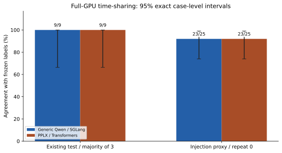
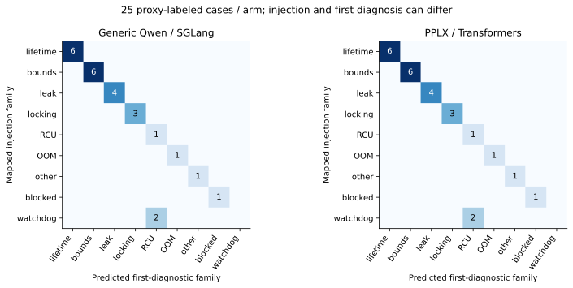
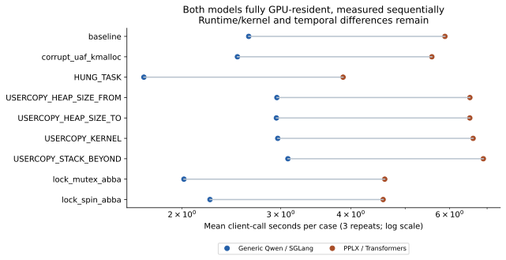
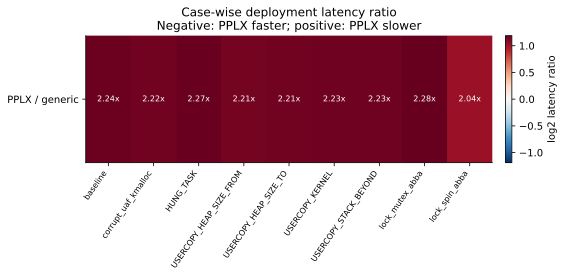

# PPLX 全 GPU 分时复用复测报告（2026-10-12）

真实 PPLX v1 专用权重与通用 Qwen 分时使用同一 A100；CPU 卸载旧结果不进入本轮对照分母。

## 已验证的运行条件

PPLX 全部参数位于 `['cuda:0']`，总参数字节 52173271520（48.590 GiB）；device map 为 `{'': 'cuda:0'}`。没有 CPU/meta 参数。固定 checkpoint revision `b01a5cbaca5391f73bd55103d4f27e8982cd5e60`。

原通用模型与 PPLX CPU sidecar 在测试时停止；先测 PPLX，再释放显存测通用模型；每阶段都确认另一模型端口及生产30000不响应，并记录GPU快照。两端BF16、相同证据、三个问题、8192上下文、串行客户端；通用实验端关闭radix前缀缓存。PPLX为官方参考Transformers/SDPA，通用为SGLang0.5.21，因此仅移除了CPU卸载/同时驻留差异，运行时、内核、提示与读出仍不同，且顺序没有交叉随机化。

9个既有test案例各3次×2端=54；其他16个映射train案例各1次×2端=32；35个未覆盖案例仅PPLX各1次=35。共121正式调用，另排除2合成预热。未知家族correct=null，未评估源码根因、引入提交或stage/reporter准确率。

## 结果

| 指标 | 通用 Qwen / 全GPU SGLang | PPLX / 全GPU参考实现 |
| --- | --- | --- |
| test调用与标签吻合 | 27/27 | 27/27 |
| test唯一案例多数正确 | 9/9 | 9/9 |
| test平均客户端秒 | 2.563 | 5.672 |
| test P95秒 | 3.093 | 6.891 |
| test API调用数 | 27 | 27 |
| test输入token总数 | 302931 | 325638 |
| test输出token总数 | 0 | 0 |
| 25例注入标签代理吻合 | 23/25 | 23/25 |

## 统计与解释

9个唯一test案例取各自3次均值，再做配对。通用减PPLX平均差 -3.110s；案例bootstrap95%区间 [-3.472, -2.724]s；探索性双侧案例符号置换p=0.003906。均值相对减少率（负值表示PPLX更慢）-121.35%。重复调用不作为27个独立样本；这些统计不消除运行时/顺序混杂，也不是跨机制显著性或模型本征速度证明。

准确率配对McNemar p=1.000000，非劣/等效未证明。既有test参与开发，不是新机制盲测。25例概率Brier仅对注入代理：通用 0.1580，PPLX 0.1539；不能声称内核领域已校准。

## 标签、泄露与失败

正式失败 0；121个匿名隔离审计均通过，121个实际请求无额外标签/案例ID/评分字段。仍有63个请求、41个唯一案例含与案例名重合的自然日志符号，存在捷径，不能称完全去线索盲测。

注入watchdog的LOOP/SOFTLOCKUP第一诊断为RCU stall；映射目标与提问构念不同。冻结目标不事后重标，返回RCU不能自动算作模型错误。未覆盖35例保留输出但不报准确率。

首次启动尝试因记录代码读取不存在的hf_device_map属性失败，0正式调用；已保留该尝试及恢复记录，修复后另起新协议目录。当前最终状态 `completed`，原模型与CPU sidecar恢复检查 `True`，Supervisor状态 `S`。

## 实际结论

PPLX已在完整GPU驻留条件下取得本轮数据，平均5.672s；通用部署本轮平均2.563s。两者家族成绩分别27/27与27/27。此前CPU卸载19.455s不再用于公平速度比较；它只描述另一部署条件。

完整Agent的根因定位收益仍未测试。若研究目标是纯权重/架构收益，应进一步统一支持专用readout的运行时及核函数，并做AB/BA交叉顺序、独立机制与专家首诊断真值验证。当前数据支持已测部署方案在已知案例上的表现，不能外推至未经测试的配置。

## 保存与复现

私有原始归档 624383 字节、536 个证据文件，SHA256 `1e6e699a0bd6fac1b456e71fa51815920300e44f7623151f417a1cc1da6a83b3`；归档及逐文件哈希在本地复核一致。排除原进程环境、账号、权重与临时制备副本。恢复后两个Decision端点合成UAF家族验收通过；Chat仅验证HTTP200和可返回，不验证生成内容。恢复验收不计入121正式调用。

公开 `results/trials.csv/json` 包含121次标量、三个问题的选择与概率，完整输入/原始轨迹仅保留私有归档。运行 `python analyze.py --public` 可离线重算本报告与科研图，不调用模型。服务器 `/opt/kernel-insight/experiments/pplx-timeshare-20261012/`；首次失败尝试在相邻20261011目录。恢复与阶段快照、全GPU参数设备断言均可追溯。

## 分析计划与相关案例敏感性

运行协议、输入与顺序在正式调用前冻结；本分析脚本在采集期间编写，统计属于探索性。按5个注入家族分别取案例差值均值，再对家族等权符号置换，p=0.062500。家族也不等于经过因果验证的独立机制；案例级区间不能被解读为任意新故障的总体区间。

## 部署验收与文档更新（2026-10-12）

最近已验证：2026-10-11 CPU卸载入口通过choice/noul/score、负例与项目客户端验收；2026-10-12冻结全GPU入口完成78次PPLX正式调用，逐参数cuda:0断言通过。分时对照后恢复原30000及30002服务，并真实执行合成UAF验证。这些部署验收不计入正式121次分母。

2026-10-12新版常驻部署已通过在线验收（北京时间2026-10-12 07:29:02）：五个部署脚本与仓库521b29c对应字节SHA256一致，30个权重文件重新核验通过；两轮choice/noul/score、项目DecisionClient、422/404负例和推理后停止→启动→再次推理均通过，共4次合成推理，不计入benchmark。PPLX PID1114，通用PID66启动身份未变，两个模型端点健康。当前常驻为CPU卸载并存配置；全GPU121次实验与此次部署验收分别保存。 证据见[新版部署验收](../../deployment/pplx-decider/validation-20261012/README.md)。

权重固定下载链接、30文件校验、依赖、CPU卸载与完整GPU命令、参数和恢复步骤见[中文部署手册](../../docs/PPLX专用模型下载部署与验收手册.md)。已更新的[学术报告](../decision-localization-20261011/report.md)与[修订版PDF](../../output/pdf/AI4Loc_Decision_Academic_Report_20261012.pdf)单列本轮全GPU研究。
